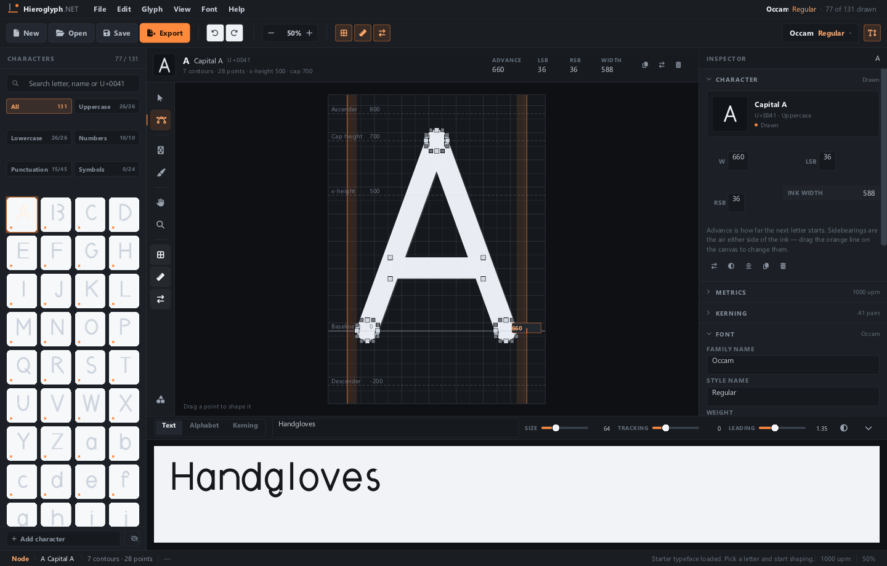
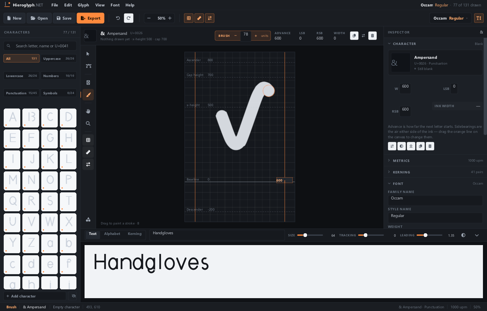
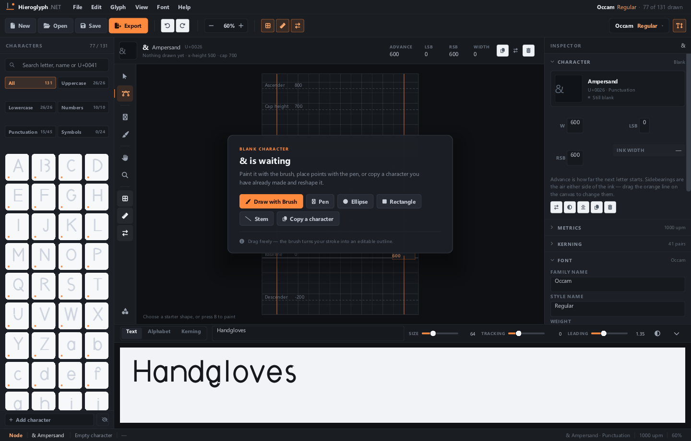
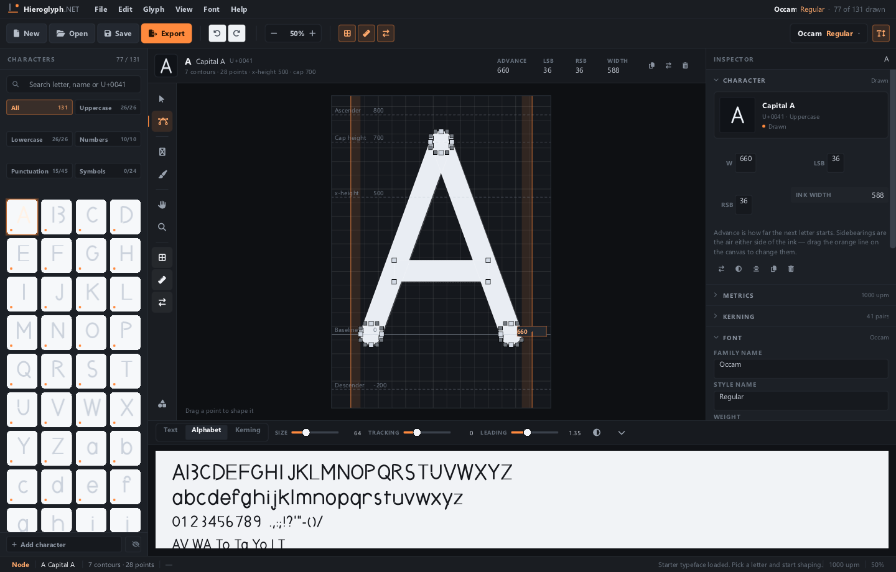
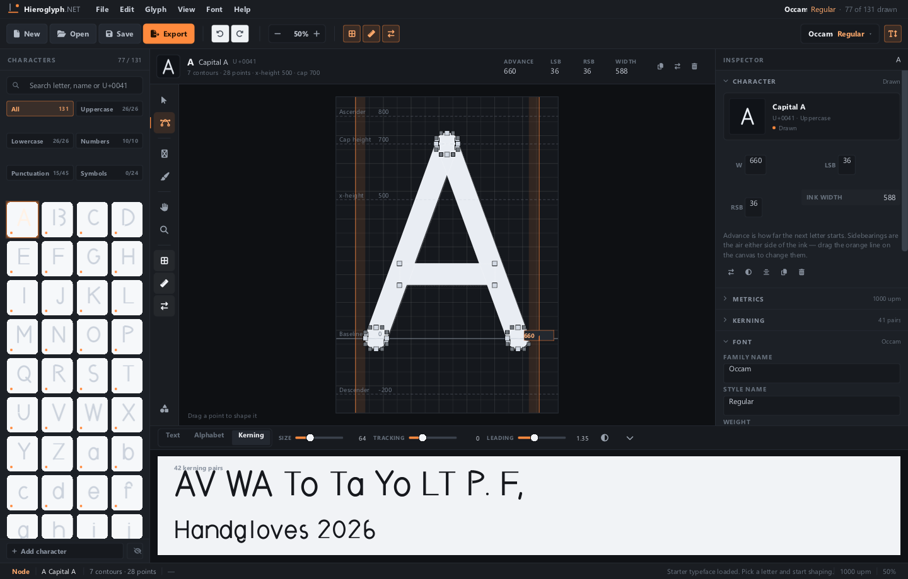
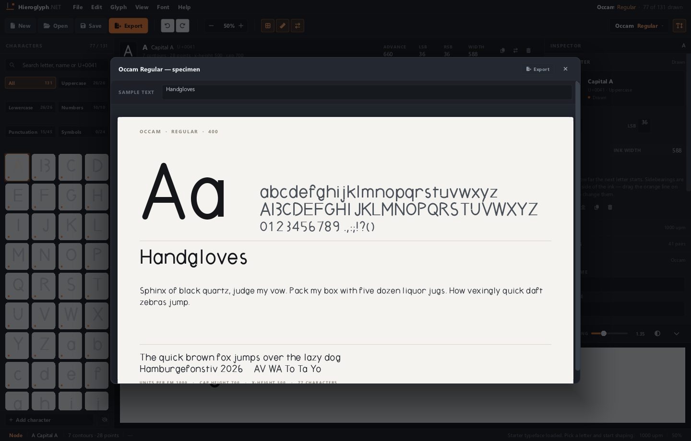
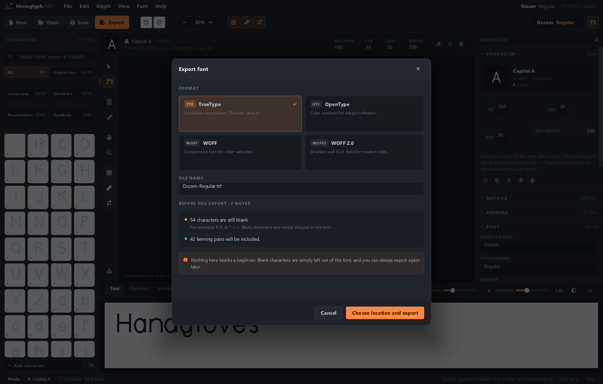

# Hieroglyph.NET

**A free, source-available typeface design application for the Open Creative Suite.** Draw a character for each letter, preview the alphabet, export a real font and install it — without an account, a subscription, a cloud upload or any font-engineering knowledge.

[](https://github.com/OpenCreativeSuite/HieroglyphDotNet/releases/latest)
[](https://opencreativesuite.github.io/HieroglyphDotNet/)



## Typeface design that feels like drawing

Hieroglyph.NET is built around the workflow people actually follow: pick a character, shape it, look at the alphabet, export. The interface is a calm, dark workspace — a character browser, a focused tool rail, a large em square, a contextual inspector and a preview dock that renders your developing typeface as you work.

- **The brush draws like a brush.** Drag freely and the stroke becomes one smooth, closed, editable outline. No clicking point by point.
- **The pen is there when you want it.** Cubic Bézier anchors, mirrored handles, marquee selection and precise nudging.
- **Spacing is part of the design.** Advance width, sidebearings and kerning are visible on the canvas and editable in the inspector.
- **Real font files.** TrueType, CFF, kerning tables and web-font containers are compiled from your outlines inside the application.
- **Local by design.** Projects are plain `.hgl` JSON files. Fonts are ordinary files. Nothing is uploaded anywhere.
- **Every feature included.** No paid tier, no watermark, no account.

## What you can do with it

### Draw each character

A blank character offers a brush, a pen, an ellipse, a rectangle and a stem — or copy a character you have already drawn. Millimetre-precise work is possible; so is a quick freehand alphabet in an afternoon.

### Shape the outline

Drag anchors and handles, add and delete points, make a point smooth or sharp, constrain a move with Shift, nudge with the arrow keys, flip, centre and clear. Multiple contours and open contours are supported, and overlapping shapes merge cleanly.

### Control the metrics

Baseline, x-height, cap height, ascender and descender are drawn on the canvas. The advance width is a draggable orange line; the sidebearing zones are shaded so uneven spacing is obvious. A whole font can be rescaled by changing units per em without redrawing anything.

### Build the alphabet

The character browser lists every letter, number, mark and symbol with a live miniature and a completion dot. Search by character, name or code point, filter by category, hide finished characters, and add any Unicode character — é, €, ←, ★.

### Space it properly

A visual kerning editor previews any pair at a large size, nudges by five units, and suggests AV, VA, WA, AW, To, Ta, Yo and LT. Kerning is written to both a legacy `kern` table and an OpenType `GPOS` lookup.

### Preview and present

The preview dock renders real text, the full alphabet and kerning pairs with adjustable size, tracking, leading and ink colour. The specimen viewer presents the typeface at several sizes with a custom sample line.

### Export and install

TTF, OTF, WOFF and WOFF2, with a plain-language validation report. On Windows the font can be installed for the current user in one click. Install it, open any text application, and type.

## Made for everyday jobs

| I want to… | Hieroglyph.NET can |
| --- | --- |
| Make my first font | Start from the included *Occam* typeface or a blank sheet with all standard characters ready |
| Draw a letter quickly | Brush (<kbd>B</kbd>), then reshape the resulting outline point by point |
| Keep a curve exact | Pen (<kbd>P</kbd>) and node editing (<kbd>A</kbd>) with mirrored Bézier handles |
| Turn O into o | **Edit → Duplicate Character…** copies the outline and advance to another code point |
| Add accented characters | **Add character** accepts any character or Unicode code point |
| Fix AV and To | The kerning panel previews the pair and stores the adjustment |
| See the whole typeface | Text, alphabet and kerning previews, plus the specimen viewer |
| Install my font | **Export → Install font** on Windows; no administrator rights needed |
| Keep my work | Projects are readable `.hgl` JSON files you own |

## A look around

| Brush | Blank character | Preview dock |
| --- | --- | --- |
|  |  |  |
| A live stroke that becomes an editable outline. | Brush, pen, starter shapes or a template. | Real text with size, tracking and leading. |

| Kerning | Specimen | Export |
| --- | --- | --- |
|  |  |  |
| Pairs previewed with their adjustments applied. | Large glyphs, a paragraph and the metrics. | Four formats and a friendly validation report. |

## Get started in a minute

1. **Download a build for your computer.** Windows, Linux and macOS builds are attached to the [latest release](https://github.com/OpenCreativeSuite/HieroglyphDotNet/releases/latest). Unzip it and run `HieroglyphDotNet` (`HieroglyphDotNet.exe` on Windows). There is no installer.
2. **Create a font.** Choose **File → New Font…**, give it a name, and pick “Starter outlines” if you want a complete alphabet to reshape.
3. **Draw a letter.** Pick a character in the browser, press <kbd>B</kbd> and drag, or press <kbd>P</kbd> and click to place points.
4. **Shape it.** Press <kbd>A</kbd> and drag anchors or handles. The arrows nudge; <kbd>Shift</kbd> constrains.
5. **Preview.** Type in the dock at the bottom and watch the alphabet fill in.
6. **Export.** Press <kbd>Ctrl</kbd>+<kbd>E</kbd>, choose TTF, pick a folder and install it.

## Run from source

You need the [.NET 10 SDK](https://dotnet.microsoft.com/download).

```sh
dotnet run
```

Or start the built `HieroglyphDotNet` executable from `bin/`. The desktop host also accepts `--screenshot <path>` for a headless frame capture.

## Licence

Hieroglyph.NET is free for personal and commercial use, including internal business use. The source is available under the **Apache License 2.0 with the Commons Clause**: you can use, modify and share it, but you may not sell the software itself or a product whose value derives substantially from it. **The typefaces you make are yours** — export them, use them and sell them.

See [LICENSE.md](LICENSE.md) for the full terms and a plain-English summary.

## Learn the app

The illustrated guide lives in [`docs/`](docs/index.html) and is published at:

**https://opencreativesuite.github.io/HieroglyphDotNet/**

It covers drawing, typography and previews, exporting and installing, the full shortcut list, and how to build from source.

## Project layout

```
Program.cs                     application root and overlay stack
src/Core/                      documents, geometry, editing, font compilation
  Glyph.cs, FontProject.cs     characters, contours, metrics, styles
  FontEditor*.cs               session, tools, input, files and commands
  GlyphRasterizer.cs           antialiased scanline rasteriser for previews
  StrokeOutline.cs             freehand brush → editable outline
  TrueTypeOutlines.cs          cubic → quadratic conversion
  CffTable.cs                  Type 2 charstrings and the CFF container
  OpenTypeTables.cs            cmap, name, OS/2, hhea, head, maxp, post, kern, GPOS
  SfntBuilder.cs               sfnt, WOFF and WOFF2 containers
  DemoFont.cs                  the Occam starter typeface
src/Components/                chrome, browser, canvas, inspector, preview, dialogs
src/Components/App/App.css     the entire visual identity
docs/                          user guide and screenshots
.github/workflows/             GitHub Pages and cross-platform release builds
```

The font compiler and the glyph model are independent of the UI. Glyph rendering uses a custom anti-aliased scanline rasteriser, and export writes every table the formats need from the same outlines the editor draws.

## Free and private

Hieroglyph.NET is free to use and will stay free. There is no paid version, subscription, account, advertising or telemetry. Projects and exported fonts are read and written on your computer. No font service, cloud upload or external account is involved at any point.

## Project links

- [Latest release](https://github.com/OpenCreativeSuite/HieroglyphDotNet/releases/latest)
- [User guide](https://opencreativesuite.github.io/HieroglyphDotNet/)
- [Documentation source](docs/)
- [Website workflow](.github/workflows/pages.yml) and [release workflow](.github/workflows/release.yml)
- [Report an issue](https://github.com/OpenCreativeSuite/HieroglyphDotNet/issues)
